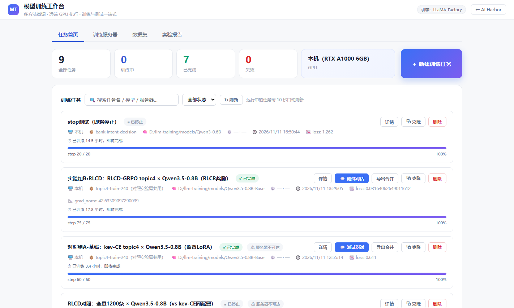
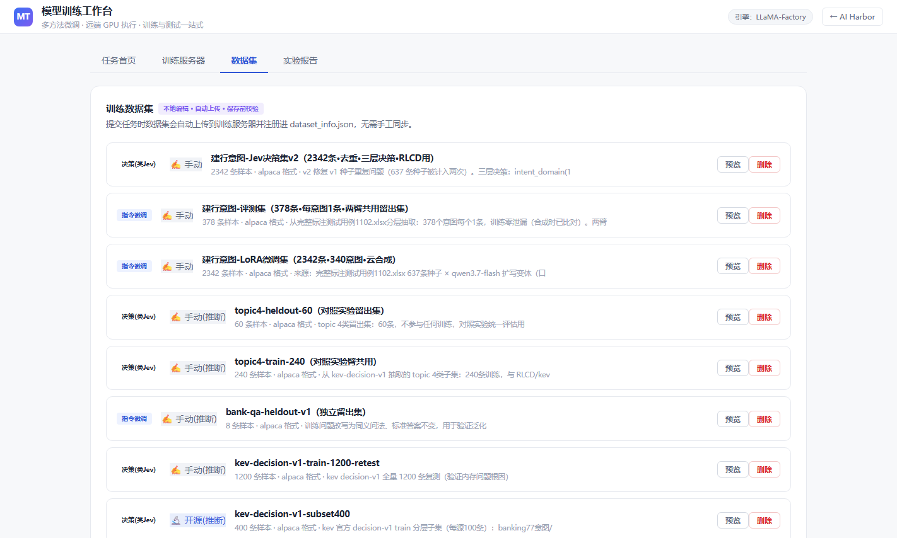
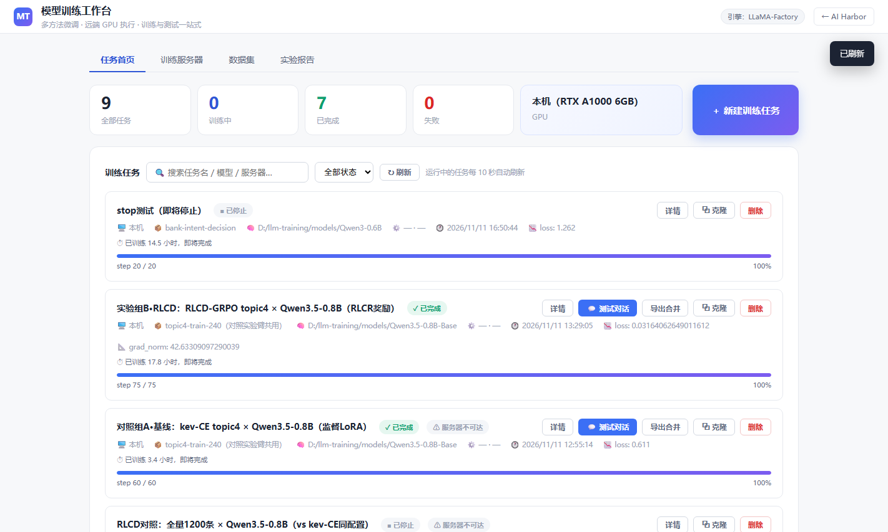
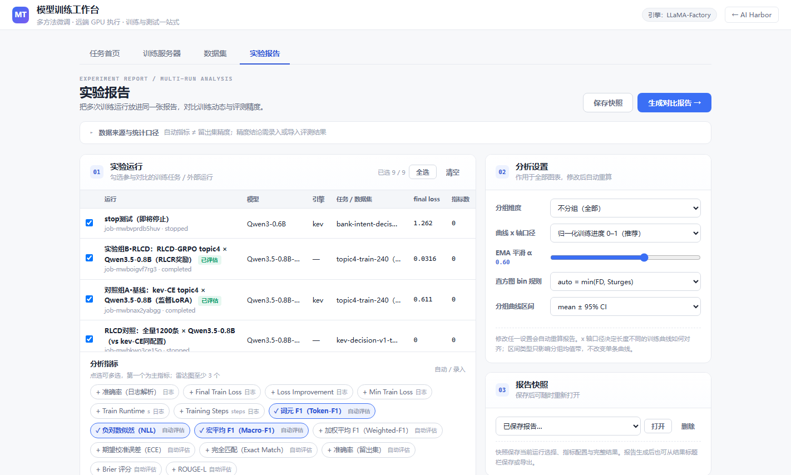
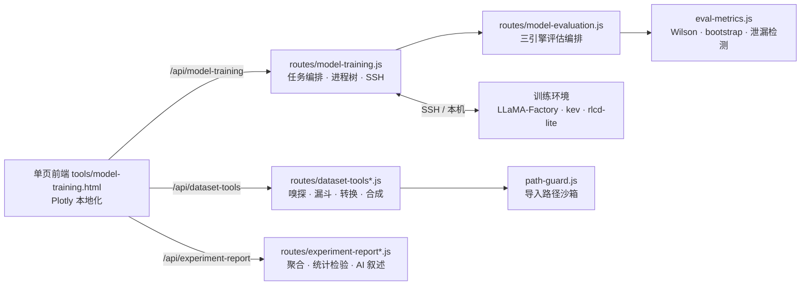

<p align="center">

</p>

# Model-Builder

从数据集合成到训练任务、自动评估、实验对比报告的一站式本地工作台。单进程 Node 服务 + 单页前端，两个 npm 依赖即可跑起来。

> [!TIP]
> 界面截图全部来自真实运行（`docs/images/`）。

## 是什么

面向个人与小团队的**本地大模型训练全流程工具**。它把训练 LLaMA-Factory / kev / RLCD 作业时的手工环节做成了界面：造数据（合成 + 七段质检漏斗）→ 提交训练（进程树管理）→ 训练完自动评估（Wilson + record-level bootstrap 双置信区间）→ 多任务实验对比（Plotly 图表 + 可选 AI 叙述）。

不依赖云服务：训练跑在本机或 SSH 远端（如一台有 GPU 的 Linux 机器），图表用本地化的 Plotly（无 CDN），密钥只进环境变量。

## 它解决什么问题

跑对照实验（如「LoRA vs RLCD 谁的意图识别更准」）时，散落的脚本和数据有四个坑：

| 坑 | 本工具的做法 |
|---|---|
| 训练只产 loss 曲线，精度靠手抄 | 训练完成自动在留出集推理打分（accuracy/F1/ECE/Brier + 逐样本留痕），指标带来源标签自动进报告 |
| 合成数据无质检等于投毒 | 7 段质检漏斗 + 评测集泄漏隔离 |
| 两个引擎各一套口径，数字不可比 | 统一评估协议：Wilson + record-level bootstrap 双置信区间，平台自算与引擎官方数字交叉校验 |
| 结果散在聊天记录里 | 实验报告页：Plotly 本地图表（分组曲线/直方图/雷达/平行坐标）+ AI 叙述（事实包引用回锚，数字白名单校验） |

## 特性

- **7 段质检漏斗**：空值 / 布局归一 / 精确去重 / 语义去重（3-gram Jaccard）/ 长度截断 / 语言过滤 / 评测集泄漏隔离，每段独立计数
- **7 种合成模式**：evol / rewrite / label-variant（按标签扩写）/ rule-map（零 LLM 成本）/ decision few-shot 等，支持种子注入与「禁止编造」约束
- **8 种数据布局**：alpaca / sharegpt / openai_messages / qa_pairs / dpo_standard / alpaca_preference / pretrain_text / decision_kev，互转 fail-closed（二次归一化直接报错）
- **三训练引擎**：LLaMA-Factory（yaml 生成 + 断点续训 + 克隆）、kev benchmark、RLCD-GRPO（rlcd-lite）
- **进程树击杀**：Windows / Linux 下递归杀子进程不留孤儿；任务删除连带清理 data/ logs/ saves/ 全部产物与评估临时件
- **自动评估**：训练完成即跑留出集，accuracy / macro-F1 / EM / token-F1 / ROUGE-L / 校准（ECE + Brier），指标回写任务并进实验报告
- **双置信区间**：Wilson（快）与 record-level bootstrap（1000 次按记录重采样，处理多问题记录的单元相关性）
- **实验报告**：多任务指标聚合 + 统计检验 + Plotly 本地图表；AI 叙述仅引用事实包内数字并回锚到图表
- **路径沙箱**：数据导入白名单（`DATASET_IMPORT_ROOTS`），realpath 二次校验，`..` / 符号链接 / 大小写变体均逃不出去

## 快速开始

```bash
git clone https://github.com/wanshoulu/Model-Builder.git
cd Model-Builder
npm install && npm start     # → http://127.0.0.1:3000
```

打开浏览器就是工作台首页（任务列表 + 新建训练任务向导）。训练执行需要一台 Python 训练环境（本机或 SSH 远端），全部环境变量见 `.env.example`。

## 渐进式使用

**第一步：体验界面与质检（不需要训练环境）**

把一份 alpaca 格式数据粘贴进「数据集」页签导入，质检漏斗立即给出 7 段剔除计数与通过率：

<p align="center">

</p>

**第二步：接上训练环境**

「训练服务器」页签注册本机或 SSH 远端（workdir / cli 路径 / 凭据）后，「新建训练任务」向导即可选数据集与模型提交。任务列表实时刷新，点「详情」看 Loss 曲线与产物：

<p align="center">

</p>

**第三步：训练后评估与实验对比**

建任务时勾选「训练后评估」与评估集，完成后自动打分并回写；「实验报告」页签勾选多个任务生成对比图表：

<p align="center">

</p>

## 架构



## 名词表

| 名词 | 含义 |
|---|---|
| SFT | Supervised Fine-Tuning，指令微调（alpaca 格式 instruction/output） |
| decision 数据 | 决策格式样本：`state`（用户话语）+ `questions`（追问选项树），kev 引擎的多问题输出用 |
| RLCD | Reinforcement Learning from Contrastive Divergence，对比散度强化学习（rlcd-lite 实现） |
| 质检漏斗 | 七段串行过滤器，任一段剔除即出局，输出每段计数与通过率 |
| 语义去重 | 3-gram Jaccard ≥ 0.85 判为重复（decision 样本指纹只用 state，避免模板字段误杀） |
| 泄漏隔离 | 训练集与评测集做指纹比对，重复样本自动剔除并计数 |
| Wilson CI | 单比例置信区间，快但不处理预测单元间的相关性 |
| record-level bootstrap | 按独立记录重采样 1000 次求区间，一条记录多问题时区间更诚实（更宽） |
| 断点续训 | LLaMA-Factory resume：从上次 checkpoint 的 optimizer 状态继续 |

## 测试

```bash
npm test    # 12 套 173 项回归（含安全加固与 fail-closed 用例）
```

## 目录

```
server.js                  独立入口（静态 tools/ 白名单 + 3 组 API）
routes/                    11 个路由模块（训练/数据集/评估/报告/沙箱）
tools/model-training.html  单页前端（内嵌样式与脚本，零构建）
tools/vendor/plotly.min.js Plotly 本地化（MIT，随仓库分发）
tests/                     12 套测试 + run-all 启动器
```

## 已知限制

- 免登录设计，默认只听 127.0.0.1；公网部署需自行加反向代理鉴权
- RLCD 引擎暂只支持本机训练环境（脚本依赖 `TRAINING_ROOT` 布局）
- 语义去重是 n-gram 近似，不等于语义级查重（同义不同词的重复检不出）
- AI 叙述需要云 LLM 密钥（`QWEN_KEY` 等）；不配置时统计与图表完全可用

## License

MIT（Plotly.js 以 MIT 随仓库分发；LLaMA-Factory / kev / rlcd-lite 为外部训练环境，需另行安装）
